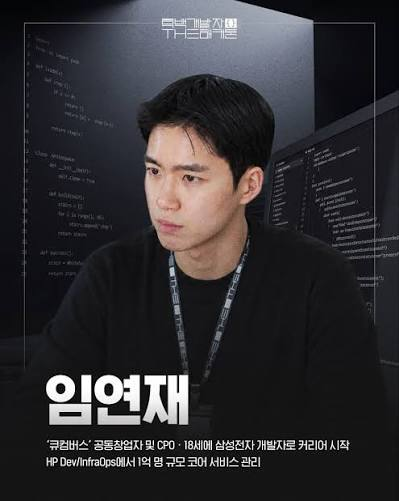
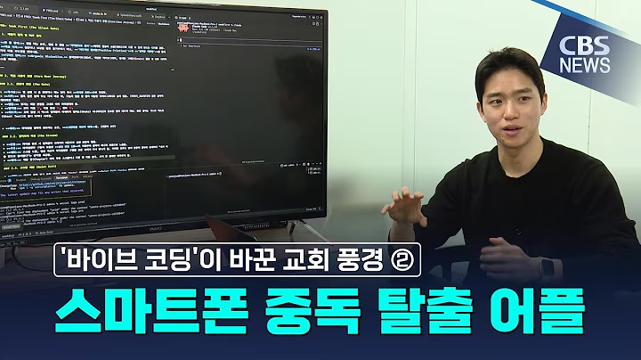
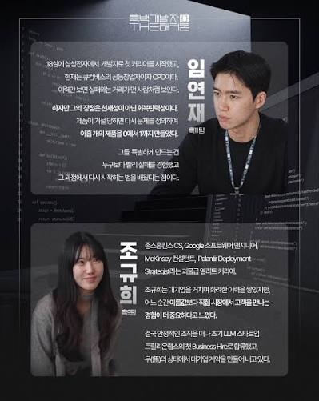

# Yeonjae Im · 임연재

**Founder at [SENEH](https://seneh.ai). Engineer. Product builder.**

I build technology around the people who need it.

Today, I’m building **[RUAH](https://github.com/yeonzae/ruah)**: a voice AI companion to help older adults stay **safe and independent**, and give their families **peace of mind**.

Previously, I worked as a software engineer at **Samsung Electronics** and **HP**, and as co-founder and CPO at **Cucumber**, building products for older adults and families navigating dementia care.

[LinkedIn](https://www.linkedin.com/in/yeonjae-im/) · [SENEH](https://seneh.ai) · [RUAH](https://ruah.seneh.ai) · [Instagram](https://www.instagram.com/ruahforyou/)

 

## Building RUAH

**Older adults deserve technology that fits their lives.**

We’re building a companion that people can talk to naturally, with the goal of supporting independent living and helping families stay connected when they cannot be there in person.

My work spans product discovery, firmware integration, real-time voice AI, backend systems, and deployment. Recent work includes a working ESP32 conversational prototype, a deployed voice backend with persistent memory, an operations dashboard, and a public early-access website.

**[Explore the project →](https://github.com/yeonzae/ruah)** · **[Visit RUAH →](https://ruah.seneh.ai)** · **[Watch our story →](https://www.instagram.com/reel/DeJpoSyIrVc/)**

## Selected work

| Project | What I built | Explore |
| :--- | :--- | :--- |
| **RUAH** | Voice AI and a physical companion prototype for older adults; cloud services and early-access onboarding. | [Project](https://github.com/yeonzae/ruah) · [Website](https://ruah.seneh.ai) |
| **시선 · Seek First** | An app that asks users to type a Bible verse before opening other apps, helping them begin the day intentionally. | [CBS feature](https://christian.nocutnews.co.kr/news/6513131) |
| **Church community tools** | Small-group reporting and a dashboard for ministry leaders; a public church website. | [CBS feature](https://christian.nocutnews.co.kr/news/6513131) · [Website repository](https://github.com/yeonzae/sncw_home) |

## Featured

**CBS News · May 6, 2026** — A feature on 시선 and the church small-group management app I built, showing how ideas became tools people could use.

[Read the article and watch the segment →](https://christian.nocutnews.co.kr/news/6513131)

<strong>Developer feature · 흑백개발자</strong>

 

Editorial images provided for this profile.

## Let’s build

I’m interested in voice AI, accessible consumer products, aging, and the connection between software and the physical world.

**[Connect on LinkedIn →](https://www.linkedin.com/in/yeonjae-im/)**
